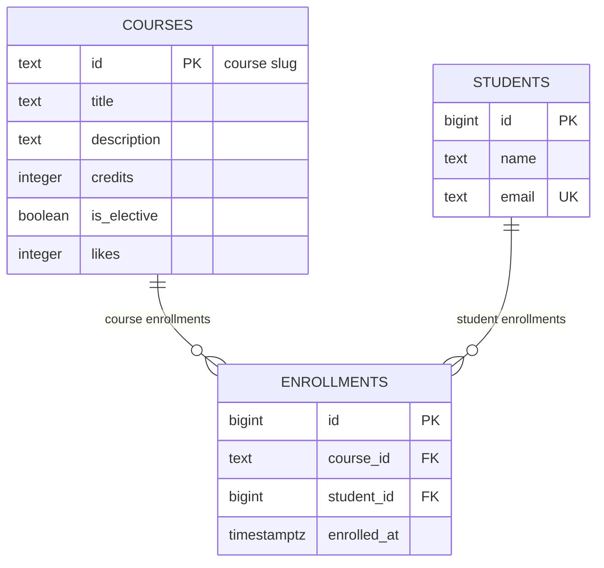

# course-catalog-db

Лабораторная 6 PostgreSQL Designing a Database Schema. Три таблицы и SQL для маршрутов Course Catalog. Фактическая проверка выполнена 29 октября 2026 на PostgreSQL 17.4 от роли `catalog_app` без прав суперпользователя. После финального запуска: **6 курсов, 3 студента, 6 записей**, сумма likes 122. Файлы FastAPI и Next.js менять для этой лабораторной не требуется.

## How to run

Нужны PostgreSQL 16+ и psql. В Windows установлен PostgreSQL 17 в `C:\Program Files\PostgreSQL\17\bin`. Добавьте эту папку в PATH либо вызывайте psql по полному пути. Перед запуском в PowerShell: `$env:PGCLIENTENCODING = 'UTF8'`.

На пустом сервере один раз от postgres выполните:

```sql
CREATE ROLE catalog_app LOGIN NOSUPERUSER NOCREATEDB NOCREATEROLE;
\password catalog_app
CREATE DATABASE course_catalog OWNER catalog_app;
CREATE DATABASE idx_demo OWNER catalog_app;
CREATE DATABASE norm_demo OWNER catalog_app;
```

`\password` запрашивает пароль интерактивно, поэтому он не попадает в репозиторий. `norm_demo` зарезервирована для необязательного задания по нормализации.

Из папки проекта выполните:

```powershell
psql -X -h localhost -U catalog_app -d course_catalog -v ON_ERROR_STOP=1 -f schema.sql
psql -X -h localhost -U catalog_app -d course_catalog -v ON_ERROR_STOP=1 -f seed.sql
psql -X -h localhost -U catalog_app -d course_catalog -v ON_ERROR_STOP=1 -f queries.sql
psql -X -h localhost -U catalog_app -d course_catalog -v ON_ERROR_STOP=1 -f verify.sql
```

`schema.sql` удаляет и пересоздаёт только три учебные таблицы, затем создаёт индекс. Для повторного заполнения запустите сначала schema.sql, затем seed.sql. Один seed.sql повторно не запускайте: UNIQUE правильно отклонит дубликаты. Queries.sql допускает повторное выполнение; изменяющие запросы откатываются, но sequence может пропускать номера.

На этом компьютере можно запустить отдельный локальный сервер без Windows-службы:

```powershell
powershell -ExecutionPolicy Bypass -File .\start-local.ps1
```

Он использует `127.0.0.1:55439`, создаёт три БД и выполняет schema.sql, seed.sql, queries.sql и verify.sql при первом запуске. Существующие таблицы при повторном запуске сохраняются. Пароли генерируются в `.local/connection.json`; папка исключена из Git и архива. Подключение:

```powershell
$c = Get-Content .\.local\connection.json -Raw | ConvertFrom-Json
$env:PGPASSWORD = $c.appPassword
& 'C:\Program Files\PostgreSQL\17\bin\psql.exe' -X -h 127.0.0.1 -p $c.port -U catalog_app -d course_catalog
Remove-Item Env:PGPASSWORD
```

Остановка: `powershell -ExecutionPolicy Bypass -File .\start-local.ps1 -Stop`.

## Schema



Курсы и студенты связаны отношением многие ко многим через enrollments. Каждая запись относится ровно к одному студенту и одному курсу; пара `(course_id, student_id)` уникальна. Имена и email хранятся в students, название и описание курса — в courses.

## Design decisions

- `courses.id` — текстовый slug: совпадает с URL и идентификаторами из предыдущих лабораторных, понятен человеку, но длиннее числа и требует стабильного написания. `students.id` — bigint GENERATED ALWAYS AS IDENTITY: короткий стабильный технический ключ, который не зависит от изменения имени или email; он не обязан идти без пропусков.
- `RESTRICT` на course_id не позволяет удалить курс с записями. `CASCADE` на student_id автоматически удаляет записи удаляемого студента: они не имеют смысла без него, а остальные студенты и курсы сохраняются.
- `timestamptz` хранит момент времени, который отображается в часовом поясе сессии. `timestamp` не определяет однозначный момент без внешнего знания пояса. У text нет произвольного ограничения длины как у varchar(n); реальные правила задаются CHECK, например минимум два символа в имени.

## Constraint violation log

Команды выполнены с `\set VERBOSITY verbose`. Полный фактический вывод: [results/05-constraints.txt](results/05-constraints.txt). В PostgreSQL 17 NOT NULL сообщается через COLUMN NAME, а не отдельное имя ограничения.

| № | Проверка | SQLSTATE | Ограничение или столбец | Ответ будущего API |
|---|---|---|---|---|
| 1 | NULL в courses.title | 23502 | COLUMN NAME title | 422; 500, если обязательное значение пропущено из-за ошибки кода после валидации |
| 2 | credits = 0 | 23514 | courses_credits_check | 422 |
| 3 | likes = -1 | 23514 | courses_likes_check | 500, так как счётчик меняет серверный код |
| 4 | Имя A | 23514 | students_name_check | 422 |
| 5 | Повтор email | 23505 | students_email_key | 409 Conflict |
| 6 | Повтор course id | 23505 | courses_pkey | 409 Conflict |
| 7 | Повтор записи на курс | 23505 | enrollments_course_id_student_id_key | 409 Conflict |
| 8 | Несуществующий курс | 23503 | enrollments_course_id_fkey | 404 |
| 9 | Несуществующий студент | 23503 | enrollments_student_id_fkey | 404 |
| 10 | Удаление курса с записями | 23503 на PostgreSQL 17 | enrollments_course_id_fkey | 409 Conflict |
| 11 | Удаление Daniyar Bekov | 00000, успешно | enrollments_student_id_fkey ON DELETE CASCADE | 204; записей 6 → 3, после ROLLBACK снова 6 |

На PostgreSQL 18 RESTRICT при удалении может вернуть 23001. Ответы HTTP здесь — политика будущего обработчика; база возвращает SQLSTATE, а не HTTP.

Pydantic проверяет запрос API и даёт клиенту понятную ошибку, но данные могут записывать также SQL-консоль, импорт или другой сервис. Ограничение БД действует для всех способов записи и не допускает повреждения данных даже при ошибке в коде. В текущем models.py min_length=2 уже задан для имени; правила credits и likes должны быть согласованы с моделями при подключении PostgreSQL в следующей работе.

Для воспроизведения после чистых schema.sql и seed.sql:

```powershell
psql -X -h localhost -U catalog_app -d course_catalog -f experiments/constraints.sql
```

Десять ERROR в этом файле намеренные; после них данные остаются 6/3/6.

## Index EXPLAIN before and after

Запрос: `SELECT * FROM enrollments WHERE student_id = 777;`. База idx_demo содержит 500 курсов, 20 000 студентов и 50 000 записей. Генератор полностью соответствует заданию. Подготовка и измерение:

```powershell
psql -X -h localhost -U catalog_app -d idx_demo -v ON_ERROR_STOP=1 -f schema.sql
psql -X -h localhost -U catalog_app -d idx_demo -v ON_ERROR_STOP=1 -f experiments/indexes.sql
```

Скрипт удаляет индекс student_id только в idx_demo, загружает данные, выполняет по три EXPLAIN ANALYZE до и после CREATE INDEX. Для повторного опыта сначала снова выполните schema.sql в idx_demo. Главная БД не изменяется.

| Метрика | До индекса | После индекса |
|---|---|---|
| Access method | Seq Scan | Bitmap Heap Scan + Bitmap Index Scan |
| cost | 0.00..1042.00 | 4.31..15.59 |
| Rows Removed by Filter | 49997 | 0, отдельный Filter отсутствует |
| Execution Time, минимум из трёх | 2.845 ms | 0.013 ms |
| Все три измерения | 2.850 / 2.975 / 2.845 ms | 0.097 / 0.014 / 0.013 ms |

План до:

```text
Seq Scan on enrollments  (cost=0.00..1042.00 rows=3 width=34)
  Filter: (student_id = 777)
```

План после:

```text
Bitmap Heap Scan on enrollments  (cost=4.31..15.59 rows=3 width=34)
  Recheck Cond: (student_id = 777)
  -> Bitmap Index Scan on enrollments_student_id_idx (cost=0.00..4.31 rows=3 width=0)
       Index Cond: (student_id = 777)
```

Реальный полный вывод: [results/08-indexes.txt](results/08-indexes.txt). Таблица занимает 3336 kB, индекс 896 kB. Время зависит от машины и кеша.

1. PRIMARY KEY и UNIQUE автоматически создают индексы, FOREIGN KEY — нет. UNIQUE `(course_id, student_id)` подходит для поиска по первому столбцу course_id; для поиска только по student_id в этом эксперименте PostgreSQL 17 использовал Seq Scan. Поэтому отдельный индекс на student_id нужен.
2. В courses всего шесть строк на одной странице: Seq Scan дешевле прохода через индекс. В enrollments надо проверить 50 000 строк, поэтому получение трёх строк через индекс значительно дешевле. Фактический план для маленькой таблицы сохранён в results/09-small-table.txt.
3. Индекс ускоряет поиск всех записей конкретного студента и поиск его дочерних записей при каскадном удалении. Обратная сторона — дополнительное место и работа при INSERT, UPDATE и DELETE.

Итоговый schema.sql содержит `CREATE INDEX enrollments_student_id_idx ON enrollments(student_id);`.

## Transaction

Сценарий: два INSERT для нового студента и его записи. В experiments/transactions.sql первый INSERT корректен, второй ссылается на отсутствующий курс и получает 23503. Следующий SELECT отклонён с 25P02: транзакция прервана до ROLLBACK. После отката Madina отсутствует, значит первый INSERT также отменён. Вывод: [results/06-rollback.txt](results/06-rollback.txt).

Успешный вариант проверен через два независимых подключения: A держит транзакцию открытой, B выполняет SELECT. До COMMIT B видит 0 студентов и 0 записей Madina, после — 1 и 1. Уровень изоляции read committed. Вывод: [results/07-two-sessions.txt](results/07-two-sessions.txt).

Для воспроизведения откройте два psql к course_catalog. В окне A:

```sql
BEGIN;
INSERT INTO students(name,email) VALUES ('Madina Ospanova','madina@example.com');
INSERT INTO enrollments(course_id,student_id)
SELECT 'web-security',id FROM students WHERE email='madina@example.com';
```

В окне B выполните запрос до COMMIT, затем повторите после COMMIT в A:

```sql
SELECT count(*) FROM students WHERE email='madina@example.com';
SELECT count(*) FROM enrollments e JOIN students s ON s.id=e.student_id
WHERE s.email='madina@example.com';
SHOW default_transaction_isolation;
```

В A выполните `COMMIT;`: счётчики в B изменятся с 0 на 1. Без общей транзакции первый INSERT мог бы сохраниться при ошибке второго — остался бы студент без созданной записи. После опыта верните исходные данные через schema.sql и seed.sql; успешный опыт сам по себе временно даёт 4 студентов и 7 записей.

## Self review against the checklist

| Проверка | Результат |
|---|---|
| Keys | Да: три PK, два FK, UNIQUE email и пары course_id/student_id |
| Types | Да: integer для credits/likes, bigint identity для номеров, timestamptz для момента записи |
| Required values | Да: все доменные поля NOT NULL, PK также запрещает NULL; defaults false, 0, now() |
| Constraints | Да: credits > 0, likes >= 0, char_length(name) >= 2; имя согласовано с Pydantic |
| Deletion | Да: RESTRICT для курса, CASCADE для студента, оба поведения проверены |
| Normalization | Да: нет списков в ячейках, имя и email студента не дублируются в enrollments |
| Indexes and names | Да: UNIQUE покрывает course_id, отдельный индекс student_id; snake_case и без избыточных индексов |

В results сохранены фактические проверки обоих повторных запусков queries.sql, всех ограничений и полной повторной сборки schema.sql → seed.sql → queries.sql → verify.sql. Ошибки ожидаются только в экспериментах с нарушением ограничений и прерванной транзакцией.

Локальная история Git содержит отдельные изменения схемы, данных, запросов, ограничений, индекса и отчёта. Для сдачи требуется также публикация репозитория course-catalog-db в своём GitHub и проверка отображения Mermaid там. Удалённый репозиторий этим комплектом не создаётся.
